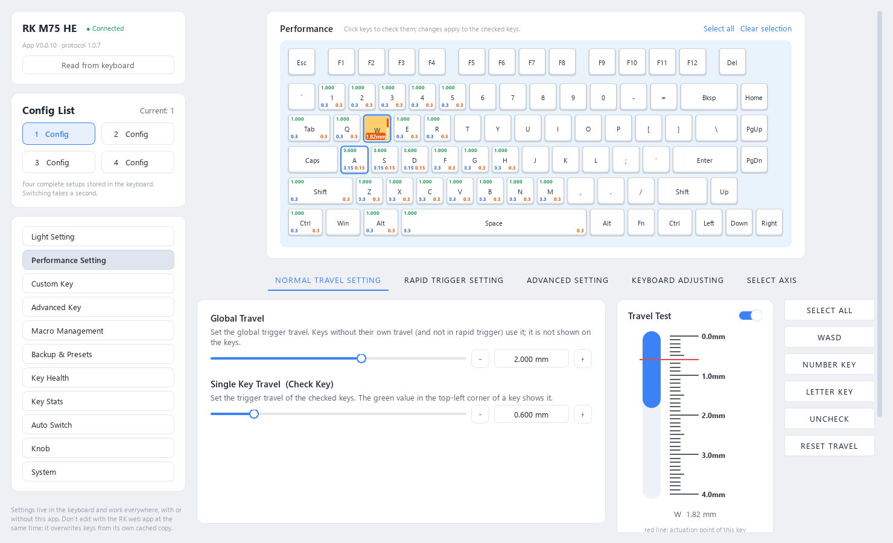
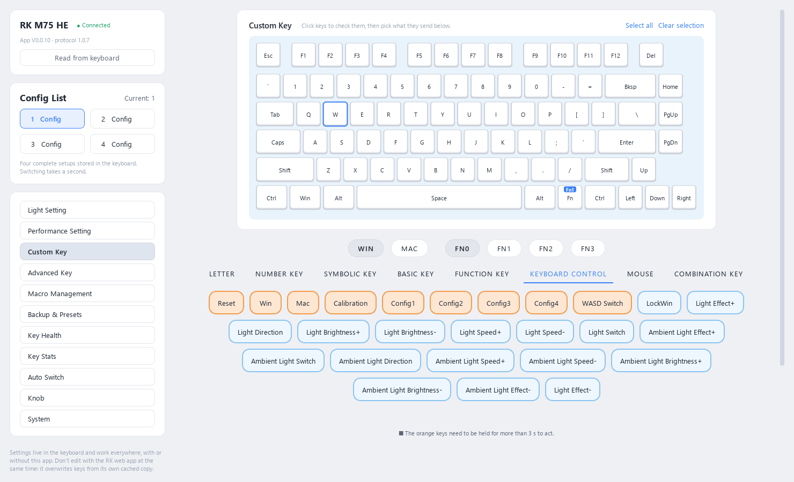
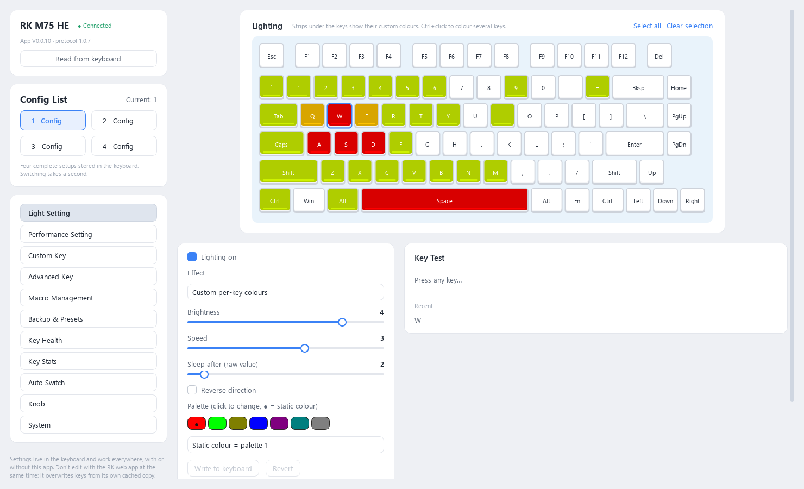
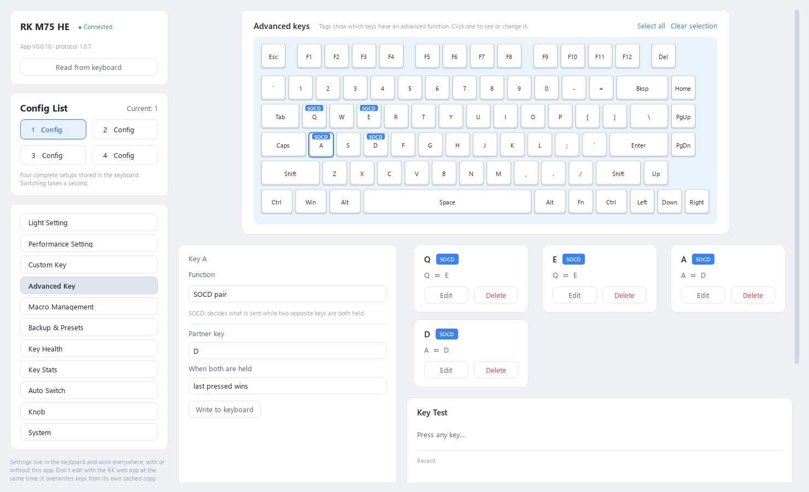
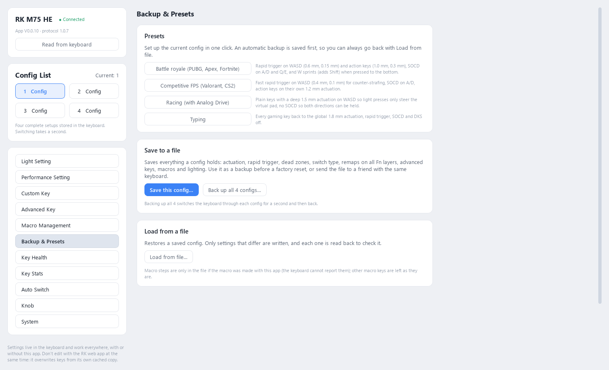
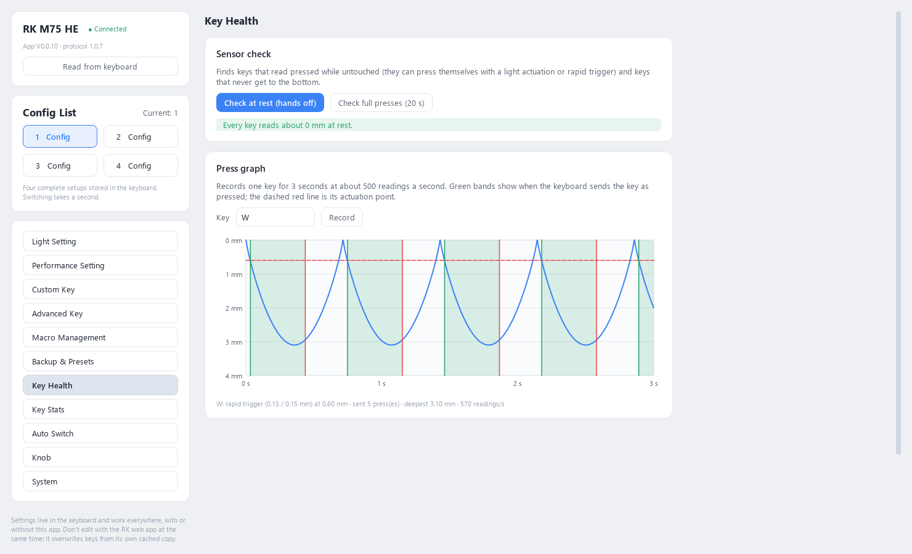
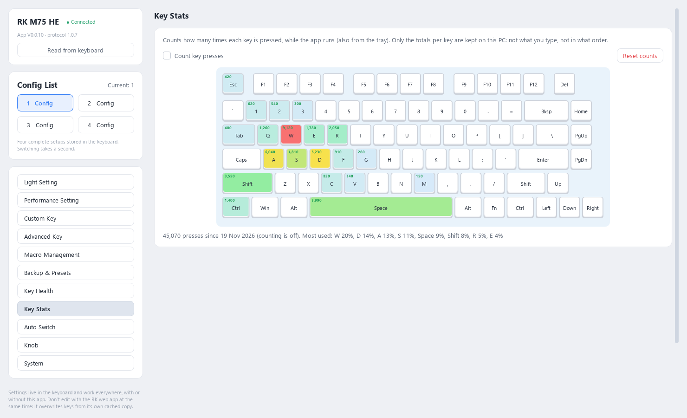
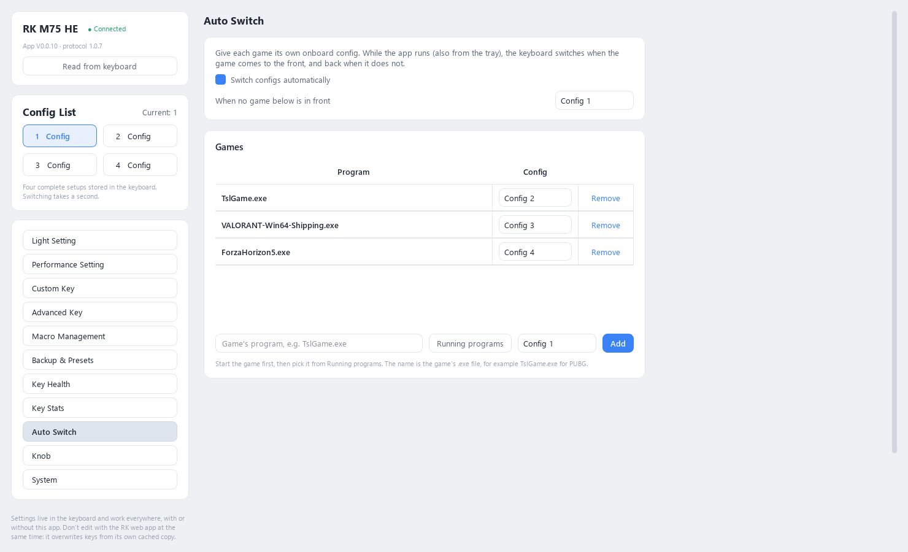
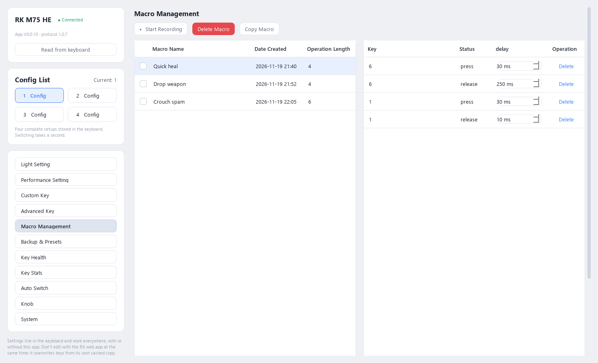

<div align="center">


# Open HE Config

**Open-source configurator for RK Hall effect keyboards, as a Windows app.**
Rapid trigger, per-key actuation, DKS, SOCD, macros, lighting, backups, per-game configs and more.
No browser, no account, nothing to install on the keyboard.

[](https://github.com/darsaliq00/open-he-config/releases/latest)
[](https://github.com/darsaliq00/open-he-config/releases)
[](LICENSE)


**[Download the latest version](https://github.com/darsaliq00/open-he-config/releases/latest)**: the
portable `.exe` runs from anywhere, or use the installer.



</div>

## Why

RK's own tool is a web page. Open HE Config is a fast native app that looks and works like RK's
web driver, then adds what it is missing: backups, one-click presets, automatic config switching
per game, a sensor health check, a live press graph and a key usage heatmap. Every change is read
back from the keyboard to confirm it, and settings stay stored in the keyboard, so they work on
any PC.

## Features

<table>
<tr>
<td width="50%" valign="top">

### Performance

Per-key actuation and rapid trigger, with values shown on every key like RK's web driver. Global
travel, dead zones, switch type, calibration and polling rate. A live **Travel Test** gauge shows
how deep each key is pressed.

</td>
<td width="50%" valign="top">

### Custom Key

Remap any key on four Fn layers, for Windows and Mac. Letters, media, mouse, lighting controls,
config switching and key combinations, in the same tabs as RK's driver.

</td>
</tr>
<tr>
<td></td>
<td></td>
</tr>
<tr>
<td valign="top">

### Lighting

Effects with a live preview on screen, brightness and speed, and per-key colours.

</td>
<td valign="top">

### Advanced keys

DKS (for example, W that also sprints when pressed to the bottom), multi-point, mod-tap, toggle,
END, SOCD (snap tap), rappy snappy and macros.

</td>
</tr>
<tr>
<td></td>
<td></td>
</tr>
<tr>
<td valign="top">

### Backup & Presets

Save one config or all four to a file and load them back, after a factory reset or to share a
setup. One-click presets: **battle royale**, **competitive FPS**, **racing** and **typing**. Each
one saves a backup first.

</td>
<td valign="top">

### Key Health

Finds keys that read pressed while untouched (they can press themselves) or never reach the
bottom. The **press graph** records a key about 570 times a second and shows exactly where the
keyboard sends press and release.

</td>
</tr>
<tr>
<td></td>
<td></td>
</tr>
<tr>
<td valign="top">

### Key Stats

A heatmap of the keys you use most. It is off until you switch it on, and only per-key totals
are kept, never what you type.

</td>
<td valign="top">

### Auto Switch

Give each game its own onboard config: the keyboard switches when the game comes to the front,
and back when it leaves. It keeps working from the tray.

</td>
</tr>
<tr>
<td></td>
<td></td>
</tr>
<tr>
<td valign="top">

### Macro Management

Record macros straight from the keyboard. Rename, copy, delete and edit step delays, then put
one on any key.

</td>
<td valign="top">

### Light on your PC

The app closes to the tray and can start with Windows. In the tray it measured **0% CPU and
about 47 MB of RAM**, and it builds no window until you open it.

</td>
</tr>
<tr>
<td></td>
<td></td>
</tr>
</table>

## Supported keyboards

| Keyboards | Status |
|---|---|
| **RK M75 HE** | Fully supported and tested |
| Other RK Hall effect boards in RK's web driver list (USB `1CA2:1601`-`161B`) | Detected and drawn from the layout the keyboard reports. Settings stay read-only until you allow writes for that model |
| RK non-HE boards (USB VID `258A`, about 250 models) | Lighting, per-key colours and remapping, using board data from RK's own Windows software (not bundled, download it from rkgaming.com). Not tested on hardware yet |

The volume knob remap is experimental and does not work yet.

## Quick start

1. Download `OpenHEConfig-Portable.exe` from the
   [latest release](https://github.com/darsaliq00/open-he-config/releases/latest) and run it, or
   use the installer.
2. Plug in the keyboard with the cable and **close RK's web driver**: both use the same interface.
3. Click keys to select them, change settings, and they are written and checked right away.

This app never flashes firmware. Settings are written the same way RK's web driver writes them.

## Run from source

```
python -m venv .venv
.venv\Scripts\pip install -r requirements.txt
.venv\Scripts\python run_config.py
```

`build.bat` builds `release\OpenHEConfig-Portable.exe` and the installer. The installer needs
Inno Setup 6 (`winget install JRSoftware.InnoSetup`). Every code push to `main` builds both on
GitHub and publishes them as a release.

<details>
<summary><b>Where your data is kept</b></summary>

The app's own files are kept next to `OpenHEConfig-Portable.exe` for the portable build, in
`%APPDATA%\Open HE Config` for the installed copy, and in the repository folder when run from
source.

- `macros.json`: copies of macros put on keys (the keyboard cannot report macro steps back)
- `macro_library.json`: the Macro Management list
- `effects.json`: lighting effect choices
- `app_settings.json`: tray, start-with-Windows, Auto Switch and Key Stats options
- `key_stats.json`: key press totals for Key Stats
- `backups\`: automatic backups saved before presets
- `rk_classic\`: settings for each non-HE board (these boards cannot report their settings)

Everything else (actuation, rapid trigger, remaps, lighting, advanced keys) is stored in the
keyboard itself.

</details>

<details>
<summary><b>Project layout</b></summary>

- `config_app/`: the window and its pages
- `app/protocol.py`, `app/kbconfig.py`: RK SparkLink HE configuration protocol
- `app/backup.py`, `app/presets.py`, `app/health.py`, `app/autoswitch.py`, `app/keystats.py`: the
  features behind Backup & Presets, Key Health, Auto Switch and Key Stats
- `app/device.py`, `app/layout.py`, `app/keycodes.py`: device lookup and key layouts
- `rk_classic/`: non-HE boards
  - `rkdata.py`: reader for RK's software data
  - `protocol.py`: feature reports
  - also the HID link and the window
- `kbui/`: theme, keycap view, lighting preview, travel gauge, widgets
- `tests/`: offline tests, run with `python -m unittest discover tests`

The non-HE feature-report format was learned from [Rangoli](https://github.com/rnayabed/rangoli)
by rnayabed, who reverse engineered it. The code here is written separately.

</details>

## License

GPL-3.0 or later, see [`LICENSE`](LICENSE). You may use, change and share it; versions you share
must stay under the GPL with their source available. This project is not affiliated with RK. RK
Keyboard Software and its board data belong to RK and are not part of this repository.
